# ZMK board definition for DYA2 keyboard

DYA2 キーボードの定義レポジトリです。
`このテンプレートを使用する` (`Use this template`) からレポジトリをクローンすることで、キーマップやパラメータのチューニングができます。
クローンしたレポジトリは [keymap-editor](https://nickcoutsos.github.io/keymap-editor/) での編集にも対応しています。

This repository contains ZMK board definition for DYA2 keyboard.
You can configure keymap and tune parameters by forking this repository.
This repository supports [keymap-editor](https://nickcoutsos.github.io/keymap-editor/) to edit keymap from web UI.

## Getting started

1. Clone this repository by "Use this template" button in github.
2. Edit files under `config` directory as you like. Please check [ZMK official document](https://zmk.dev/docs/customization)
   - keymap is defined in `dya2.keymap`
3. Build firmware on github actions or in your local PC as described in below.

## DYA Studio Web UI

The firmware supports [DYA Studio](https://studio.dya.cormoran.works/).

You can check and configure keymap, trackball setting and various settings from [DYA Studio](https://studio.dya.cormoran.works/) web app.

## Build on github actions

It's configured by default thanks to ZMK's template. Just pushing commit to github starts github actions.
The firmware will be available in "Actions" tab's latest build artifacts as `firmware.zip`.

## Release

Run **Build ZMK firmware** from the Actions tab and enter a version in the
`release` field. The workflow updates the active West dependencies, creates a
`release/<version>` branch from the selected commit, and commits a flattened
`config/west-dependency.yml` with every active project's commit hash. It then
builds from that commit and creates the GitHub Release and tag at the same
commit. The release branch is kept as the reproducible source for that version.

Use a new version for each release. Existing release branches are never
overwritten. Leave `release` empty to run a build without creating a release.

## Local development in this repository

Install zephyr SDK, `west` command ([official document](https://docs.zephyrproject.org/latest/develop/west/install.html)). Execute below command.

```bash
west init -l . --mf config/west-workspace.yml # It downloads dependencies to ../
# Or
# west init -l config # It downloads dependencies to ./dependencies
west update --narrow
west zmk-build
```

If build succeeds, the firmware shows up under `../build/<artifact>/zephyr/zmk.uf2`.

## Default keymap


